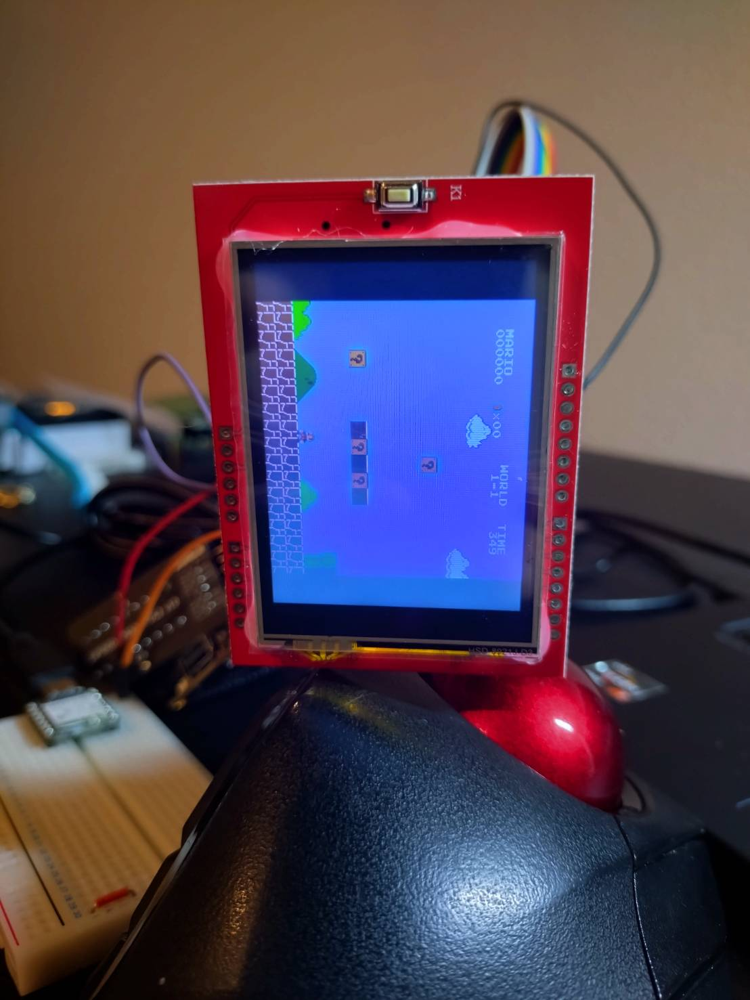
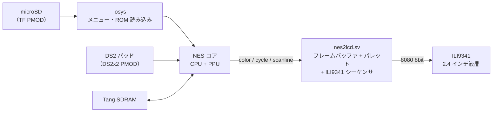

# NESTang-LCD-Primer25K

Tang Primer 25K で動く FPGA 版ファミコン（[NESTang](https://github.com/nand2mario/nestang) v0.12）の映像出力を HDMI から **2.4 インチ ILI9341 液晶（8080 8bit パラレル）** に置き換え、液晶にファミコンの画面を映せるようにしたプロジェクトです。



- FPGA の中のファミコン（CPU・PPU）が描いた画面を、自作モジュール `nes2lcd.sv` が液晶へ毎フレーム転送します
- パソコンもエミュレータも使いません。電源を入れると FPGA 単体で起動します
- 操作は DualShock2 互換パッド（PMOD Joystick Kit）

このリポジトリは、ファミコンのカセットを直接挿して遊べる携帯機を自作するプロジェクトの**工程 2** にあたります。工程 1 の ROM ダンパーは [ESP32_FamicomRomdumper](https://github.com/KK153402/ESP32_FamicomRomdumper) にあります。

---

## 目次

1. [できること・できないこと](#1-できることできないこと)
2. [構成](#2-構成)
3. [必要なもの](#3-必要なもの)
4. [配線](#4-配線)
5. [ビルドと書き込み](#5-ビルドと書き込み)
6. [使い方](#6-使い方)
7. [nes2lcd の設計](#7-nes2lcd-の設計)
8. [NESTang v0.12 からの変更点](#8-nestang-v012-からの変更点)
9. [ハマりどころ](#9-ハマりどころ)
10. [フォルダ構成](#10-フォルダ構成)
11. [ライセンス・謝辞](#11-ライセンス謝辞)

---

## 1. できること・できないこと

| 項目 | 状態 |
|---|---|
| 液晶への表示（256 × 240、等倍、左右 32 ドット黒帯） | ✅ 60 fps |
| 色・向き | ✅ 横向き（K1 ボタンを左） |
| パッド操作（1P） | ✅ |
| SD カードからの ROM 起動 | ✅（メニューは液晶に出ないため、ボタン操作で起動する。§6） |
| 電源投入だけで起動（Flash 書き込み） | ✅ |
| 音声 | ❌ 出ない（元は HDMI 経由のため） |
| ROM 選択メニューの表示 | ❌ 液晶には出ない |
| 2P | ❌ ピンを液晶に回したため |

動作確認したソフト：スーパーマリオブラザーズ（自分で所有するカセットから吸い出した ROM）

---

## 2. 構成



NESTang の `nes2hdmi.sv`（HDMI 出力）を外し、同じ信号を受け取る `nes2lcd.sv` に差し替えています。ファミコン本体（`ppu.v` など）は変更していません。

---

## 3. 必要なもの

| 部品 | 内容 |
|---|---|
| FPGA ボード | Sipeed **Tang Primer 25K** Basic Package（コアボード＋Dock） |
| SDRAM | Sipeed **Tang SDRAM V1.3**（Dock の 2×20P ヘッダ） |
| microSD | Sipeed **TF Card PMOD V2**＋microSD（FAT32） |
| パッド | Sipeed **PMOD Joystick Kit**（DS2x2 PMOD＋DualShock2 互換パッド） |
| 液晶 | **2.4 インチ ILI9341 UNO シールド**（8bit パラレル、5 V 入力。SD スロット・タッチ付きの一般的なもの） |
| 電源 | Dock 用 USB-C、液晶用 5 V（USB 充電器など） |
| 配線 | メス–メスのジャンパー線 約 20 本 |
| 開発環境 | GOWIN FPGA Designer **1.9.12.04**（Standard）、Gowin Programmer |

---

## 4. 配線

### 4.1 Dock のコネクタの使い方

| Dock | 挿すもの |
|---|---|
| J4 | TF Card PMOD（直挿し） |
| J5 | 奇数列：DS2x2 PMOD（ジャンパー線）／偶数列：液晶の制御線 |
| J6 | 液晶のデータ線（DVI PMOD の位置） |
| 2×20P | Tang SDRAM |

Dock の PMOD のピン番号は 1・2 = 3.3 V、3・4 = GND、5〜12 = 信号です。

### 4.2 DS2x2 PMOD（ジャンパー線で接続）

DS2x2 を J5 に直挿しすると偶数列がふさがるため、**J5 と DS2x2 の同じ位置どうし**を 6 本だけつなぎます。

| J5 | FPGA | 信号 |
|---|---|---|
| 1 | — | 3.3 V |
| 3 | — | GND |
| 5 | L5 | ds_clk |
| 7 | K11 | ds_miso |
| 9 | E11 | ds_mosi |
| 11 | A11 | ds_cs |

パッドは DS2x2 の 1P 側に挿します。

### 4.3 液晶

| 液晶シールド | Dock | FPGA |
|---|---|---|
| LCD_D0 〜 LCD_D7 | J6 の 5 〜 12 | H5, J5, H8, H7, G7, G8, F5, G5 |
| LCD_CS | J5 の 6 | K5 |
| LCD_RS | J5 の 8 | L11 |
| LCD_WR | J5 の 10 | E10 |
| LCD_RST | J5 の 12 | A10 |
| LCD_RD | J5 の 2（3.3 V） | —（H に固定） |
| 5V | 別電源の 5 V | — |
| GND | Dock の GND **と** 別電源の GND | — |

> [!IMPORTANT]
> **GND は必ず Dock と共通にしてください。** GND が浮いたまま信号をつなぐと、信号の H / L が決まらないうえ、液晶側から FPGA の I/O に電流が流れ込みます。電源は「液晶の 5 V と GND → Dock の USB」の順に入れます。

- LCD_RD は FPGA の H レベルと同じ 3.3 V に吊ります（5 V に吊ると、シールドのバッファが 3.3 V 電源の場合に定格を超えます）
- LCD_RS / LCD_CS はシールドによってはタッチパネルと兼用です。タッチは使いません
- 表示が乱れるときは、ジャンパー線を短くし、GND を 2 本（J6 の 3 番と J5 の 4 番など）にします

---

## 5. ビルドと書き込み

### 5.1 ソースの準備

1. NESTang **v0.12** の [Source code (zip)](https://github.com/nand2mario/nestang/releases/tag/v0.12) を展開する（master ではなく v0.12 を使う）
2. 展開したフォルダを **英数字だけ・スペースなしのパス**に置く（例：`C:\fpga\nestang-0.12\`）。日本語やスペースを含むパスでは合成が失敗します（§9）
3. このリポジトリの `src/` を、展開したフォルダの `src/` に上書きコピーする

   | このリポジトリ | 内容 |
   |---|---|
   | `src/nes2lcd.sv` | 新規 |
   | `src/nestang_top.sv` | 置き換え |
   | `src/primer25k/nestang.cst` | 置き換え |
   | `src/primer25k/nestang.sdc` | 置き換え |

   `patch` コマンドが使える環境なら、v0.12 のフォルダで `patch -p1 < patches/nestang-v0.12_lcd.patch` でも同じ結果になります。

### 5.2 Gowin の設定

1. `nestang_primer25k.gprj` を開く
2. Design タブで右クリック → **Add Files** で `src/nes2lcd.sv` を追加
3. 右クリック → Enable / Disable を次のとおりにする

   | ファイル | 設定 |
   |---|---|
   | `src/primer25k/config.v` | Enable |
   | `src/primer25k/config_snescontroller.v` | Disable |
   | `src/primer25k/nestang.cst` | Enable |
   | `src/primer25k/nestang_snescontroller.cst` | Disable |

4. Project → Configuration
   - Synthesize → Verilog Language：**System Verilog 2017**
   - Place & Route → Dual-Purpose Pin：**SSPI / MSPI / I2C / CPU / READY / DONE** の 6 つを regular IO にする
5. **Run All**。警告は 470 件ほど出ますが問題ありません（未使用ポート、音声回路の削除など）

できあがるビットストリームは `impl\pnr\nes.fs` です。

### 5.3 書き込み

| 書き込むもの | Access Mode / Operation | Start Address |
|---|---|---|
| `firmware.bin`（[NESTang v0.12 のリリース](https://github.com/nand2mario/nestang/releases/tag/v0.12)にある配布版） | External Flash Mode / exFlash Erase,Program（ファイル種別 `*.*`） | `0x0500000` |
| `impl\pnr\nes.fs` | External Flash Mode / exFlash Erase,Program | `0x0000000` |

- 試しに動かすだけなら `nes.fs` を **SRAM Mode / SRAM Program** で書き込みます（電源を切ると消えます）
- Start Address 欄は 7 桁で入力します（`0x500000` ではなく `0x0500000`）
- `firmware.bin` は一度書けば、`nes.fs` を書き直しても消えません

---

## 6. 使い方

1. microSD のルートに ROM ファイル（`.nes`）を **1 つだけ**置く
2. 液晶の 5 V → Dock の USB の順に電源を入れる
3. Dock の **READY LED が点灯**したら、液晶の初期化完了です
4. メニューは液晶に出ないので、見ないまま **2 → 下 → 2** と押す → ゲームが始まる
5. メニューに戻るときは **SELECT ＋ 下**

### ボタン対応（DS2 互換パッドの番号表記）

| パッド | ファミコン |
|---|---|
| 十字キー | 十字キー |
| 3 | A |
| 4 | B |
| 2 | A（連射）／メニューの決定 |
| 1 | B（連射） |
| START / SELECT | START / SELECT |

### LED

| LED | 意味 |
|---|---|
| READY | 液晶の初期化完了 |
| DONE | パッドの 3 番を押している間点灯（パッドの読み取り確認用） |

---

## 7. nes2lcd の設計

`src/nes2lcd.sv` は 4 つのブロックでできています。すべて NES のクロック（21.4912 MHz）1 系統で動きます。

1. **フレームバッファ**：256 × 240 × 6 bit（368,640 bit、BSRAM）。PPU が出したパレット番号を、`nes2hdmi.sv` と同じ条件で書き込む
2. **パレット**：64 色を RGB565 に変換（NESTang の `NES_PALETTE` から換算）
3. **ILI9341 シーケンサ**：初期化 → 全面黒クリア → 毎フレームの転送
4. **8080 8bit 送信器**：1 ピクセルを上位・下位の 2 バイトで送る

### 7.1 タイミング

clk = 21.4912 MHz（1 clk = 46.53 ns）、WR の L・H を各 1 clk としたとき：

| 項目 | 計算 | 値 | ILI9341 の規格 |
|---|---|---|---|
| WR の L 幅 / H 幅 | 1 clk | 46.5 ns | tWRL / tWRH ≥ 15 ns |
| 1 バイト（WR 周期） | 2 clk | 93.1 ns | tWC ≥ 66 ns |
| 1 フレームの転送 | 256 × 240 × 2 B × 93.1 ns | 11.44 ms | NES の 1 フレーム 16.64 ms 以内 |

ILI9341 の規格値はデータシートの 8080 系パラレルインターフェースの書き込みタイミング（Write cycle）によります。

### 7.2 ティアリング対策

- PPU が `scanline = 240`（VBlank の開始）に達した瞬間から転送を始める
- 読み出しは 1 ラインあたり 256 × 4 clk = 47.6 µs、PPU の書き込みは 1 ラインあたり 63.5 µs。VBlank から次のフレームのライン 0 が書かれるまで約 22 ライン（1.40 ms）あるので、**読み出しが常に書き込みより先に進み、フレームバッファ上では絵が混ざらない**
- 液晶パネル自身の描き直しとはタイミングを合わせていない（シールドに TE 端子がないため）。実機ではスクロール中も気にならない程度

### 7.3 初期化

RST L 10 ms → 120 ms 待ち → SWRESET → 120 ms → SLPOUT → 120 ms → COLMOD = 0x55（RGB565）→ MADCTL = 0x28（横向き・BGR）→ 320 × 240 を黒クリア → DISPON → 書き込み窓を CASET 32〜287 / PASET 0〜239 に設定

向きや色が合わないパネルでは、`nes2lcd` のパラメータ `MADCTL` を変えます（上下左右の反転は 0x68 / 0xA8 / 0xE8、赤と青が逆なら bit3 を反転）。

### 7.4 シミュレーション

`sim/tb_nes2lcd.sv` は、絵柄をフレームごとに変える疑似 PPU と、WR の立ち上がりでデータを取り込む液晶モデルで、全ピクセルを照合します。

```
iverilog -g2012 -o sim tb_nes2lcd.sv ../src/nes2lcd.sv && vvp sim
```

| 項目 | 結果 |
|---|---|
| 初期化コマンド列 | 01 11 3A 36 2A 2B 2C 29 2A 2B 2C … |
| 全面クリア | 153,600 バイト |
| ピクセル照合 | 4 フレーム × 61,440 ピクセル、不一致 0 |
| WR L / H 最小 | 46.5 ns / 46.5 ns |
| WR 周期最小 | 93.1 ns |
| 1 フレーム転送 | 11.44 ms |

### 7.5 リソース使用量（GW5A-LV25MG121）

| 資源 | 使用量 | 総数 | 使用率 |
|---|---|---|---|
| LUT | 10,902 | 23,040 | 47.3 % |
| Register | 6,379 | 23,040 | 27.7 % |
| BSRAM | 28 | 56 | 50 % |

---

## 8. NESTang v0.12 からの変更点

変更した箇所には、ソース中に `[LCD]` のコメントを付けています。差分の全体は `patches/nestang-v0.12_lcd.patch` です。

| ファイル | 変更内容 |
|---|---|
| `src/nes2lcd.sv` | 新規。液晶出力モジュール |
| `src/nestang_top.sv` | `nes2hdmi` を `nes2lcd` に差し替え。HDMI と DS2 の 2P のポートを削除し、液晶のポートを追加。2P の入力を「未押下」に固定。LED を READY = 液晶初期化完了に変更 |
| `src/primer25k/nestang.cst` | HDMI と DS2 2P のピンを削除し、液晶のピンを追加（§4） |
| `src/primer25k/nestang.sdc` | HDMI 用クロック `hclk5` の制約を無効化 |

---

## 9. ハマりどころ

| 症状 | 原因と対処 |
|---|---|
| `ERROR (SP0002) : Corrupted project file: .../impl/gwsynthesis/nes.prj` | プロジェクトのパスに日本語やスペースが含まれている。英数字だけのパスに移し、`impl` フォルダを消してから Run All |
| `ERROR (TA2003) : ... nestang.sdc":7 \| Can't set timing constraint to object hclk5` | HDMI を外すと HDMI 用 PLL が合成で削除される。`nestang.sdc` の 7 行目をコメントアウト（このリポジトリの sdc は対処済み） |
| 配布版の `nestang_primer25k_*.fs` では紫のロゴしか出ず、メニューが出ない | 原因は未特定。自分でビルドした `.fs` では動いた |
| Programmer の Scan Device で `No valid JTAG target` / `Cable failed to open` | コアボードを四隅から押し込む。Windows Update が入れた FTDI ドライバーを削除して GowinUSBCableDriverV5 を入れる。USB Serial Converter A の Load VCP をオフにする |
| 書き込んだのに前と変わらない | Programmer の File name が別のフォルダの `nes.fs` を指している。更新日時を確認する |
| どの `.fs` か分からなくなった | `.fs` の先頭（テキスト）にある `//CheckSum:` の値で見分ける |
| READY LED が点かない | FPGA 側の問題（ビルドか書き込み） |
| READY は点くが液晶が白いまま | 配線（RST・WR・CS・5 V・GND）を確認 |
| 表示が乱れる | ジャンパー線を短くする。GND を増やす。それでも直らなければ `nes2lcd` の `WR_LOW` / `WR_HIGH` を 2 にする（転送 22.9 ms、約 30 fps になる） |

---

## 10. フォルダ構成

```
NESTang-LCD-Primer25K/
├── README.md
├── LICENSE                         GPL-3.0（NESTang と同じ）
├── src/                            NESTang v0.12 の src/ に上書きするファイル
│   ├── nes2lcd.sv                  新規：液晶出力モジュール
│   ├── nestang_top.sv              v0.12 を改変
│   └── primer25k/
│       ├── nestang.cst             v0.12 を改変（DS2 1P＋液晶）
│       └── nestang.sdc             v0.12 を改変（hclk5 を無効化）
├── sim/
│   └── tb_nes2lcd.sv               nes2lcd のテストベンチ（Icarus Verilog）
├── patches/
│   └── nestang-v0.12_lcd.patch     v0.12 からの差分
└── docs/
    └── images/                     写真
```

ビルド済みの `nes.fs` は GitHub の Releases に置いています。ROM ファイルと Gowin の生成物（`impl/`）は含めていません。

---

## 11. ライセンス・謝辞

このリポジトリは [NESTang](https://github.com/nand2mario/nestang)（nand2mario 氏、GPL-3.0）を改変したものなので、**GPL-3.0** で公開します。新規に作成した `nes2lcd.sv` と `tb_nes2lcd.sv` も GPL-3.0 です。

- [NESTang](https://github.com/nand2mario/nestang) by nand2mario
- [fpganes](https://github.com/strigeus/fpganes) by Ludvig Strigeus（NESTang のベース）

ROM ファイルは含めていません。ROM は、自分で所有するカセットから吸い出したものを使ってください。

「ファミリーコンピュータ」「ファミコン」は任天堂株式会社の登録商標です。このプロジェクトは任天堂とは関係ありません。
